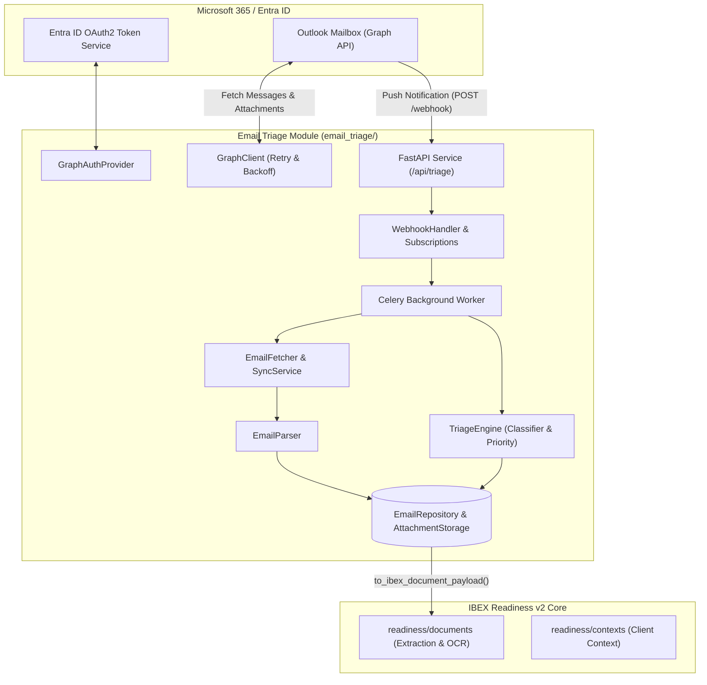

# Email Triage Module — IBEX Readiness v2

Independent, modular, and secure email ingestion and triage service built for Australian accounting practices using Microsoft Outlook / Microsoft 365 via the Microsoft Graph API.

---

## 1. What Email Triage Does

The **Email Triage** module connects to Microsoft Outlook mailboxes, automatically collects incoming client and operational emails, analyzes and categorizes them, scores urgency/priority, extracts critical financial and business entities, and safely processes attachments for integration with the IBEX document pipeline.

### Core Capabilities
- **Microsoft Graph Synchronization**: Full and incremental (Delta) synchronization of Outlook mailboxes with pagination, rate limiting (HTTP 429), and retry resilience.
- **Automated Email Triage**: Classifies emails into 10 structured categories (`Action Required`, `Urgent`, `Client Communication`, `Meeting / Scheduling`, `Invoice / Finance`, `Technical Issue`, `Information / FYI`, `Follow-up Required`, `Spam / Unwanted`, `Other`, or `Unknown / Needs Review`).
- **Actionable Priority Determination**: Evaluates text signals and deadlines to assign priority (`Critical`, `High`, `Medium`, `Low`).
- **Entity & Deadline Extraction**: Discovers monetary amounts (`$AUD`), explicit due dates, client/company names (`Pty Ltd`, `Trust`), and action flags (`action_required`, `response_required`, `follow_up_required`).
- **Executive Summaries & Next Actions**: Generates concise summaries, extracts key points, and proposes recommended next steps.
- **Secure Attachment Processing**: Validates file types and sizes, performs SHA-256 deduplication, and generates bridge payloads for IBEX's document ingestion and OCR pipeline without duplicate processing.
- **Graph Webhooks**: Real-time push notification support via Microsoft Graph subscription lifecycle (handshake validation, clientState secret verification, event deduplication, and asynchronous worker dispatch).
- **Asynchronous Task Queue**: Background Celery workers with transparent fallback to in-memory execution for standalone and testing setups.

---

## 2. Architecture and Workflow



### Ingestion Workflow
1. **Notification or Scheduled Sync**: A webhook notification is received from Microsoft Graph or a scheduled Celery sync task fires (`task_sync_mailbox`).
2. **Delta Query Execution**: `SyncService` queries Microsoft Graph using delta tokens (`/messages/delta`), fetching only new, modified, or removed messages.
3. **Parsing**: `EmailParser` cleans HTML, standardizes timestamps to UTC, extracts sender/recipients, and produces an `EmailRecord`.
4. **Attachment Extraction**: `AttachmentService` downloads file attachments, `AttachmentStorage` computes SHA-256 hashes, dedupes against existing files, and stores valid files in sharded disk storage.
5. **Triage Analysis**: `TriageEngine` runs:
   - `RuleBasedClassifier`: assigns category and confidence.
   - `PriorityEngine`: computes priority based on urgency keywords and deadlines.
   - `Categorizer`: extracts amounts, companies, dates, and action flags.
   - `RuleBasedSummarizer`: generates an executive summary, key points, and recommended actions.
6. **State Persistence**: Complete records are saved to `EmailRepository` and exposed via `/api/triage/emails`.

---

## 3. Technologies Used

- **Python 3.12+ / 3.13**: Core programming language.
- **Microsoft Graph REST API v1.0**: Protocol for accessing M365 Outlook mailboxes, attachments, delta queries, and subscriptions.
- **Microsoft Entra ID (Azure AD)**: OAuth 2.0 client credentials flow with automatic token caching and proactive refresh.
- **HTTPX**: High-performance HTTP client supporting sync/async operations, custom transports, and streaming.
- **Celery & Redis**: Distributed task queue for asynchronous ingestion, webhook processing, and periodic subscription renewals.
- **FastAPI & Uvicorn**: High-performance REST API and webhook endpoints.
- **Pydantic & Dataclasses**: Type-safe schema validation and serialization.
- **Pytest**: Comprehensive test suite mocking Graph responses without external dependencies.

---

## 4. Folder Structure

```
email_triage/
├── README.md                      # Module documentation and integration guide
├── requirements.txt               # Module dependencies
├── .env.example                   # Environment configuration template
├── config.py                      # Configuration reader and validator
├── __init__.py
│
├── authentication/                # Microsoft Entra ID OAuth2 authentication
│   ├── __init__.py
│   └── graph_auth.py              # Token provider with caching & refresh
│
├── graph_client/                  # Microsoft Graph API client layer
│   ├── __init__.py
│   ├── client.py                  # Resilient HTTP client with 429 backoff
│   ├── email_service.py           # Message retrieval, delta queries & pagination
│   └── attachment_service.py      # Attachment metadata & binary downloads
│
├── ingestion/                     # Ingestion and normalization pipelines
│   ├── __init__.py
│   ├── email_parser.py            # HTML-to-text cleaner & schema builder
│   ├── email_fetcher.py           # Filtered retrieval & deduplication
│   └── sync_service.py            # Incremental mailbox delta synchronization
│
├── triage/                        # Classification and analysis engines
│   ├── __init__.py                # TriageEngine coordinator
│   ├── classifier.py              # Rule-based & pluggable classifier
│   ├── priority_engine.py         # Priority scoring (Critical, High, Med, Low)
│   ├── categorizer.py             # Entity, deadline, and amount extraction
│   └── summarizer.py              # Summary & suggested next actions
│
├── webhooks/                      # Graph push notification handling
│   ├── __init__.py
│   ├── validators.py              # Handshake validationToken & clientState checks
│   ├── subscription_manager.py    # Subscription creation, renewal & deletion
│   └── handler.py                 # Notification parsing & task scheduling
│
├── storage/                       # Storage repositories & deduplication
│   ├── __init__.py
│   ├── email_repository.py        # Thread-safe in-memory & persistent repository
│   └── attachment_storage.py      # Hash-based attachment store & IBEX bridge
│
├── models/                        # Standardized data contracts
│   ├── __init__.py
│   └── schemas.py                 # EmailRecord, TriageResult, AttachmentMetadata
│
├── tasks/                         # Celery background tasks
│   ├── __init__.py
│   └── celery_tasks.py            # Asynchronous tasks with fallback runner
│
├── api/                           # Webhook & management API routes
│   ├── __init__.py
│   └── routes.py                  # FastAPI router and standalone app factory
│
├── utils/                         # Shared utilities
│   ├── __init__.py
│   └── logger.py                  # Sanitized logging (zero PII/token exposure)
│
└── tests/                         # Comprehensive unit & integration tests
    ├── __init__.py
    ├── conftest.py                # Fixtures and mock transports
    ├── test_api_routes.py         # API & webhook endpoint tests
    ├── test_attachment_storage.py # Attachment validation & deduplication
    ├── test_classifier.py         # Classification tests
    ├── test_email_fetcher.py      # Pagination & rate limit tests
    ├── test_email_parser.py       # HTML parsing & MIME normalization
    ├── test_priority_engine.py    # Priority scoring tests
    ├── test_tasks.py              # Background Celery task tests
    └── test_webhooks.py           # Webhook handshake & event tests
```

---

## 5. Environment Variables

Create `.env` inside `email_triage/` or set variables in your environment:

| Variable | Description | Default / Example |
|---|---|---|
| `GRAPH_CLIENT_ID` | Azure App Registration Application (client) ID | `00000000-0000-0000-0000-000000000000` |
| `GRAPH_CLIENT_SECRET` | Azure App Registration Client Secret | `replace_with_client_secret_value` |
| `GRAPH_TENANT_ID` | Microsoft Entra Directory (tenant) ID | `00000000-0000-0000-0000-000000000000` |
| `TARGET_MAILBOX` | UPN / Email of mailbox to ingest | `triage@yourpractice.com.au` |
| `CELERY_BROKER_URL` | Redis URL for Celery message broker | `redis://localhost:6379/0` |
| `CELERY_RESULT_BACKEND` | Redis URL for Celery task results | `redis://localhost:6379/1` |
| `TASK_ALWAYS_EAGER` | Execute background tasks synchronously (no Redis required) | `True` (dev/test), `False` (prod) |
| `WEBHOOK_NOTIFICATION_URL` | Public HTTPS endpoint for Graph webhooks | `https://triage.yourpractice.com.au/api/triage/webhook` |
| `WEBHOOK_CLIENT_STATE` | Shared secret token for webhook verification | Cryptographic random string |
| `MAX_ATTACHMENT_SIZE_BYTES` | Maximum allowed attachment size | `26214400` (25 MB) |
| `ALLOWED_ATTACHMENT_EXTENSIONS`| Permitted attachment file types | `.pdf,.docx,.xlsx,.csv,.txt,.png,.jpg,.jpeg` |
| `ATTACHMENT_STORAGE_DIR` | Directory for stored attachments | `./storage_data/attachments` |
| `REPOSITORY_STORAGE_PATH` | File path for persistent JSON storage | `./storage_data/triage_store.json` |
| `SANITIZE_LOGS` | Redact PII, tokens, and credentials in logs | `True` |

---

## 6. Microsoft Entra Application Registration

1. Go to the [Microsoft Entra Admin Center](https://entra.microsoft.com/) -> **App registrations** -> **New registration**.
2. **Name**: `IBEX Readiness - Email Triage`.
3. **Supported account types**: `Accounts in this organizational directory only (Single tenant)`.
4. Under **Certificates & secrets**, generate a new **Client Secret** and copy its value to `GRAPH_CLIENT_SECRET`.
5. Note the **Application (client) ID** (`GRAPH_CLIENT_ID`) and **Directory (tenant) ID** (`GRAPH_TENANT_ID`).

---

## 7. Microsoft Graph Permissions Required

Under **API permissions** -> **Add a permission** -> **Microsoft Graph** -> **Application permissions**:

| Permission | Type | Reason |
|---|---|---|
| `Mail.Read` | Application | Read emails and attachments in all mailboxes or via application access policy. |
| `Mail.ReadWrite` *(Optional)* | Application | Required if you wish to mark triaged emails as read or flag them. |
| `User.Read.All` | Application | Resolve mailbox owners and identity metadata. |

> [!IMPORTANT]
> Click **Grant admin consent for [Tenant Name]** after adding application permissions. To limit access to only specific triage mailboxes rather than the entire organization, configure an [Exchange Application Access Policy](https://learn.microsoft.com/en-us/graph/auth-limit-mailbox-access).

---

## 8. How to Install Dependencies

From the repository root or inside `email_triage/`:

```bash
pip install -r email_triage/requirements.txt
```

---

## 9. How to Run the Module Locally

You can launch the independent FastAPI service using Uvicorn:

```bash
uvicorn email_triage.api.routes:app --host 127.0.0.1 --port 8085 --reload
```

Interactive OpenAPI documentation is available at `http://127.0.0.1:8085/docs`.

---

## 10. How to Run Celery Workers

When running in asynchronous mode (`TASK_ALWAYS_EAGER=False`):

```bash
celery -A email_triage.tasks.celery_tasks.celery_app worker --loglevel=info -Q default
```

To run Celery Beat for periodic subscription renewal (every 12 hours):

```bash
celery -A email_triage.tasks.celery_tasks.celery_app beat --loglevel=info
```

---

## 11. How to Configure Redis

Using Docker:

```bash
docker run -d --name ibex-redis -p 6379:6379 redis:7-alpine
```

Set in `.env`:
```env
CELERY_BROKER_URL=redis://localhost:6379/0
CELERY_RESULT_BACKEND=redis://localhost:6379/1
TASK_ALWAYS_EAGER=False
```

---

## 12. How to Configure Webhooks

1. Ensure `WEBHOOK_NOTIFICATION_URL` is publicly reachable via HTTPS (e.g. using `ngrok http 8085` during development).
2. Set `WEBHOOK_CLIENT_STATE` in your `.env`.
3. Create the webhook subscription programmatically using Python:

```python
from email_triage.graph_client.client import GraphClient
from email_triage.webhooks.subscription_manager import SubscriptionManager

client = GraphClient()
manager = SubscriptionManager(client)
sub = manager.create_mail_subscription(
    mailbox="triage@yourpractice.com.au",
    notification_url="https://triage.yourpractice.com.au/api/triage/webhook",
    client_state="your-secure-secret-state",
)
print("Subscription Created ID:", sub.subscription_id)
```

Microsoft Graph will perform an immediate GET handshake with `validationToken`, which the `/api/triage/webhook` endpoint echoes back automatically.

---

## 13. How to Execute Email Synchronization

### Via Python Script
```python
from email_triage.tasks.celery_tasks import task_sync_mailbox

# Executes incremental sync for configured TARGET_MAILBOX
summary = task_sync_mailbox()
print("Sync Result:", summary)
```

### Via API
```bash
curl -X POST "http://127.0.0.1:8085/api/triage/sync?mailbox=triage@yourpractice.com.au"
```

---

## 14. How to Run Tests

The module includes a comprehensive unit test suite that runs without requiring a Microsoft account or network access:

```bash
python -m pytest email_triage/tests -v
```

All 35 tests verify:
- Ingestion, parsing, and HTML stripping.
- Category classification across all 10 categories.
- Urgency and priority scoring.
- Attachment validation, hashing, and deduplication.
- Webhook subscription validation and deduplication.
- Eager Celery task execution.
- REST API and webhook endpoints.

---

## 15. Example API Requests and Responses

### 1. List Triaged Emails
`GET /api/triage/emails?priority=High&category=Invoice%20%2F%20Finance`

**Response (`200 OK`):**
```json
{
  "count": 1,
  "total": 1,
  "limit": 50,
  "offset": 0,
  "items": [
    {
      "internal_id": "8939f85-338d-42f6-8897-9f88ecf9231e",
      "graph_message_id": "AAMkAGI2AAAt1234=",
      "subject": "Tax Invoice #1042 - Acme Pty Ltd",
      "sender_name": "Alice Smith",
      "sender_email": "alice@acme.com.au",
      "received_at": "2026-11-20T10:15:30Z",
      "has_attachments": true,
      "processing_status": "TRIAGED",
      "triage": {
        "category": "Invoice / Finance",
        "priority": "High",
        "confidence": 0.88,
        "action_required": true,
        "response_required": true,
        "follow_up_required": false,
        "suggested_action": "Verify invoice details, check ABN and match with accounting records.",
        "due_date": "25 November",
        "summary": "Email from Alice Smith regarding 'Tax Invoice #1042 - Acme Pty Ltd'. Please find attached our tax invoice for payment.",
        "key_points": [
          "Includes attachment(s): Tax_Invoice_1042.pdf",
          "Total amount due is $4,500.00 EFT remittance."
        ],
        "entities": {
          "amounts": ["$4,500.00"],
          "companies": ["Acme Pty Ltd"],
          "due_date": "25 November",
          "sender_name": "Alice Smith"
        }
      }
    }
  ]
}
```

### 2. Webhook Validation Handshake (Graph to Server)
`GET /api/triage/webhook?validationToken=EchoThisToken123`

**Response (`200 OK`, `text/plain`):**
```
EchoThisToken123
```

### 3. Webhook Notification Receiver
`POST /api/triage/webhook`

**Request Body:**
```json
{
  "value": [
    {
      "subscriptionId": "sub-101",
      "clientState": "your-secure-secret-state",
      "changeType": "created",
      "resource": "Users/triage@example.com/Messages/AAMkAGI2AAA=",
      "resourceData": {
        "id": "AAMkAGI2AAA="
      }
    }
  ]
}
```

**Response (`202 Accepted`)**

---

## 16. Integration with the Main IBEX Application

The module is engineered to integrate cleanly into the core IBEX Readiness v2 architecture:

### 1. Document Extraction & OCR Integration
When an email attachment is downloaded, `AttachmentStorage` outputs `ibex_compatible_payload`:
```python
{
    "source": "email_triage",
    "original_filename": "Client_BAS_2026.pdf",
    "sha256": "4a7d...3b1f",
    "size_bytes": 128450,
    "storage_path": "storage_data/attachments/4a/4a7d...3b1f.pdf",
    "content_type": "application/pdf",
    "needs_ocr": False,
    "is_inline": False,
    "display_name": "Email Attachment: Client_BAS_2026.pdf"
}
```
This payload directly matches the constructor requirements for `readiness.documents.models.DocumentVersion`, allowing attachments to feed directly into `documents/extraction.py` and `documents/ocr.py` without duplicate OCR pipelines.

### 2. Client Context Matching
When emails are ingested, the extracted companies and sender domains can be mapped to `readiness.contexts.native.Client` or the IBEX CRM connector (`readiness.contexts.crm.CrmContextProvider`) by matching sender emails or company names.

### 3. Optional Django App Mount
To mount Email Triage into the main Django web server, add `"email_triage"` to `INSTALLED_APPS` and include the router in Django's ASGI router or URL patterns.
# Email_Triage

